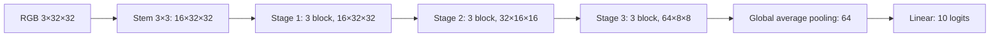

# Method–CNN và thiết lập thí nghiệm — Minh, tuần 2

## Kiến trúc ResNet

Nhóm sử dụng ResNet cho ảnh CIFAR-10 RGB 32×32, gồm stem tích chập 3×3 stride 1, ba stage residual với số kênh 16/32/64. Mỗi stage có ba basic block; mỗi block gồm hai convolution 3×3 và BatchNorm. Mạng giảm kích thước không gian ở block đầu stage 2 và 3, sau đó global average pooling và lớp linear 10 đầu ra.

Một block tính `y = ReLU(F(x) + S(x))`. `S(x)` là identity nếu hai nhánh cùng kích thước; khi đổi số kênh hoặc stride, dùng projection convolution 1×1 cùng stride và BatchNorm. Bản này dùng projection shortcut có tham số (option B); khác shortcut option A trong thí nghiệm CIFAR của bài ResNet gốc. Mã được triển khai bằng các building block PyTorch trong `src/models/resnet.py`; không dùng trọng số pretrained.

ResNet có 272.474 tham số trainable, ViT tự cài có 274.282; chênh lệch `abs(272474−274282)/274282 ≈ 0,659%`, đạt mục tiêu nội bộ không quá 10%. Buffer BatchNorm không được tính là tham số trainable.

## Hàm mục tiêu và chọn checkpoint

Dùng CrossEntropyLoss trên logits `[B,10]` và nhãn lớp long `[B]`. Mô hình không softmax trước loss; khi suy luận, evaluator dùng softmax để xuất phân phối xác suất. Train/validation chia sẻ cách tính accuracy nhưng validation chạy eval và tắt gradient; BatchNorm/Dropout do đó có hành vi phù hợp từng giai đoạn.

Mỗi lượt chọn checkpoint có validation accuracy cao nhất; nếu hòa giữ epoch sớm hơn. `last.pt` lưu để resume, `best.pt` lưu để đánh giá. Checkpoint bao gồm model/buffer, optimizer, scheduler, RNG, generator DataLoader, epoch, số bước và hash manifest. Test chính thức chỉ đánh giá sau khi khóa toàn bộ phương pháp và checkpoint cuối, không dùng trong tuần 2.

## Tuning và giao thức chính

Cả ResNet và ViT được thử hai recipe trên cùng 50% train, 10 epoch mỗi recipe: SGD lr 0,05, momentum 0,9, weight decay 0,0005; AdamW lr 0,001, weight decay 0,05. Dùng cùng split seed 2026 và train seed 42, batch 128, cùng crop/flip/chuẩn hóa, cosine schedule và quy tắc chọn checkpoint. Chọn bằng best validation accuracy; không mở tập test.

Kết quả tuning chọn SGD cho ResNet và AdamW cho ViT. Các lượt chính khởi tạo lại từ đầu; cùng 100 epoch ở mọi tỷ lệ, giữ recipe của từng kiến trúc theo `configs/week2/locked_protocol.json`. Tuning ngang số lượt/ảnh/epoch không đồng nghĩa ngang FLOPs hoặc thời gian GPU; recipe khác nhau là giới hạn khi diễn giải riêng tác động của kiến trúc.

Với ResNet và batch 128, số cập nhật mỗi epoch lần lượt là ceil(4500/128)=36, ceil(22500/128)=176, ceil(45000/128)=352; đủ 100 epoch tương ứng 3.600/17.600/35.200 cập nhật. Cùng epoch nhưng lượng dữ liệu khác nhau kéo theo số cập nhật và chi phí khác nhau, cần nêu trong Limitations.

Tuần 2 mới có một cặp seed, nên độ lệch chuẩn mẫu chưa xác định (N/A). Số liệu và thời gian đo thực tế được bổ sung vào bản kết quả; không đưa số tuning vào bảng chính và không suy ra độ ổn định từ một seed.

## Nguồn và AI

Kiến trúc tham khảo He et al., *Deep Residual Learning for Image Recognition*, arXiv:1512.03385. API optimizer/scheduler theo tài liệu PyTorch 2.11. Swin prototype dùng torchvision 0.26 và chưa huấn luyện ở tuần 2; không ghi phần thư viện này là nhóm tự cài.

AI hỗ trợ xây mã, thử cấu hình, chạy thí nghiệm, kiểm tra và soạn ghi chú. Minh cần tự đọc, kiểm tra số liệu và giải thích code/thiết lập khi vấn đáp; không coi file ghi chú là bằng chứng đã hoàn tất vấn đáp cá nhân.
