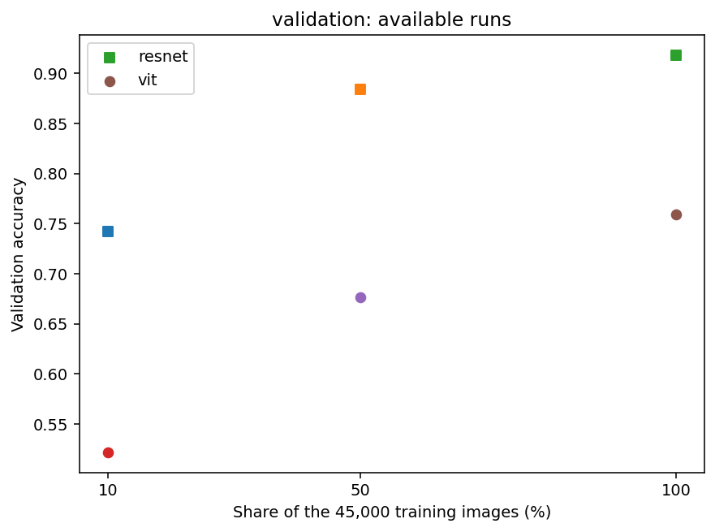

# Sáu lượt P0 tuần 2 — giao thức nhóm đã chốt

Ngày thực hiện: **14/11/2026**. Đã pull/fetch main, hien và lanh; merge vào nhánh Minh, đọc [báo cáo hỗ trợ Lan Anh](../../docs/bao-cao-tuan2-lan-anh-ho-tro.md), chạy mới ba ViT GPU theo đúng YAML hiện hành. Minh vận hành GPU hỗ trợ Lan Anh; tác giả/đầu việc mô hình ViT vẫn là Lan Anh.

## Kết quả validation sau 100 epoch

| Mô hình | Tỷ lệ | Train | Đúng / 5.000 | Best validation | Best epoch | Cập nhật | Train tổng (giây) |
|---|---:|---:|---:|---:|---:|---:|---:|
| resnet | 10% | 4,500 | 3,712 | 74.24% | 96 | 3,600 | 104.29 |
| resnet | 50% | 22,500 | 4,420 | 88.40% | 89 | 17,600 | 498.78 |
| resnet | 100% | 45,000 | 4,590 | 91.80% | 95 | 35,200 | 1001.87 |
| vit | 10% | 4,500 | 2,608 | 52.16% | 70 | 3,600 | 96.41 |
| vit | 50% | 22,500 | 3,383 | 67.66% | 96 | 17,600 | 467.54 |
| vit | 100% | 45,000 | 3,795 | 75.90% | 84 | 35,200 | 900.67 |

Cùng split_seed=2026/train seed=42, batch 128, 100 epoch và cosine schedule. Tỷ lệ tính trên 45.000 train, cùng manifest phân tầng/lồng nhau. ViT AdamW lr **0.0003**, wd 0.05, dropout 0.1; ResNet SGD lr **0.05**, momentum 0.9, wd 0.0005. Best checkpoint chọn bằng validation accuracy, hòa giữ epoch sớm hơn. **Tập test chưa đánh giá**. Mỗi dòng chỉ một seed, std mẫu N/A.

Ba ResNet là các run GPU đã hoàn thành trước đó, được kiểm tra cấu hình thực tế khớp hoàn toàn YAML nhóm mới; giữ nguyên tên, checkpoint và provenance, không tính thành lượt mới. Ba ViT được chạy mới từ đầu, không nối các checkpoint CPU 5 epoch và không dùng recipe ViT lr 0.001 từ giai đoạn tuning trước.

## Đối chiếu kỹ thuật

- Mỗi run đủ `config.yaml`, `metadata.json`, `metrics.csv`, `best.pt`, `last.pt`; đủ 100 epoch và 3.600 / 17.600 / 35.200 cập nhật tương ứng ba tỷ lệ.
- Model: ResNet **272.474** và ViT **274.282** tham số; cùng manifest SHA-256 `d888fd1e3a2c0e121b60b55337dbecf68cef9d65dfc6fc372e2ca2a81d916e19`.
- Evaluator độc lập trên **CUDA** khớp chính xác best validation accuracy của trainer ở cả sáu run. TensorBoard có đủ epoch 1–100, không thiếu/trùng.
- Phát hiện CPU đánh giá lại ViT 10% đếm 2.607/5.000, GPU đếm 2.608/5.000; best epoch đều 70. Không sửa checkpoint/số liệu hoặc nới điều kiện kiểm tra. Đã thêm chọn thiết bị cho `src.visualize`, mặc định theo thiết bị train trong metadata, dùng cùng thiết bị cho attention; ghi thiết bị đánh giá vào CSV hình.
- **39 kiểm thử đạt**, không test bị skip; có ba trường hợp hồi quy cho lựa chọn thiết bị vẽ. Script đóng gói còn được kiểm tra thực tế: từ chối lượt đang dở mà không tạo ZIP.
- Mã train/kiến trúc/dữ liệu dùng giữa các run không bị đổi; full-source hash của ResNet và ViT có thể khác vì nhánh đã bổ sung công cụ visual giữa hai giai đoạn. Metadata và `p0_runs.csv` giữ hash/commit thực tế, không ghi lại lịch sử. Sửa `src.visualize` sau train không làm thay đổi checkpoint đã tạo.

## Bảng và hình bàn giao

- [p0_runs.csv](p0_runs.csv), [p0_summary.csv](p0_summary.csv): chỉ sáu run 100 epoch theo giao thức nhóm, validation.
- `results/runs.csv` được cập nhật thành đúng sáu run P0; bảng ViT 5 epoch trước đó được lưu nguyên ở [prior_vit_5epoch_runs.csv](prior_vit_5epoch_runs.csv) và các file lịch sử của Lan Anh, không xóa bằng chứng.
- [checks.json](checks.json): kiểm tra epoch, tham số, hash, checkpoint, số ảnh và thiết bị.
- [Bảng hình validation](visualizations/validation.csv): gồm 6 learning curve, 6 confusion matrix, 3 attention map và 1 biểu đồ data scaling.
- [Attention ViT 10%](visualizations/4_vit_0.10_attention.png), [50%](visualizations/5_vit_0.50_attention.png), [100%](visualizations/6_vit_1.00_attention.png): lấy ảnh đúng/sai đầu tiên theo manifest, CLS → patch ở block cuối, trung bình các head, lưới 8×8; màu thể hiện tương đối trong từng ảnh. Attention không chứng minh nhân quả quyết định mô hình.
- [Accuracy theo lượng dữ liệu](visualizations/accuracy_data.png). ResNet cao hơn ViT ở cả ba mức trong đúng recipe/seed này; không suy ra mọi CNN luôn hơn mọi ViT hay khẳng định riêng inductive bias gây ra chênh lệch.

## ZIP chuyển cho Hiền

Đã chuẩn bị **6 ZIP** tại `runs/handoff/team_week2/`, mỗi ZIP là toàn bộ thư mục run gồm TensorBoard và dự đoán validation. Mỗi ZIP được kiểm tra CRC và SHA-256; [handoff_manifest.json](handoff_manifest.json) ghi đường dẫn/checksum/kích thước và kết quả.

Bản gộp tiện gửi: `runs/handoff/team_week2_all_runs.zip`, chứa sáu ZIP cùng checksum và manifest. Checkpoint/ZIP lớn nằm ngoài Git. Chưa gửi file qua dịch vụ ngoài; người dùng chuyển gói này cho Hiền. Ma trận `results/hien_week2/run_matrix.csv` đánh dấu **ready_for_handoff** cho P0, không giả định Hiền đã tiếp nhận.

## Phần còn lại của nhóm

Hai seed bổ sung P1 và đánh giá test cuối chưa chạy. Các hình đã tạo để bàn giao nhưng việc Lan Anh/Hiền đọc chéo và xác nhận kết luận vẫn cần thực hiện. Các ghi nhận CPU 5 epoch/tuning được giữ như lịch sử, không dùng thay ngân sách P0 hiện hành. Đọc [hướng dẫn thực thi](../../docs/vit-gpu-week2-execution.md) và [giao thức](../../docs/experiment_protocol.md) trước khi tiếp tục.
