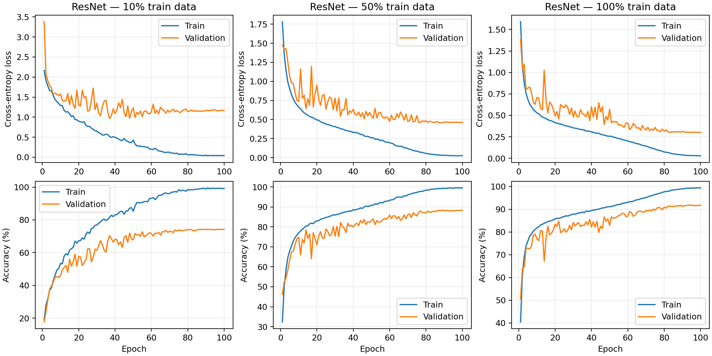
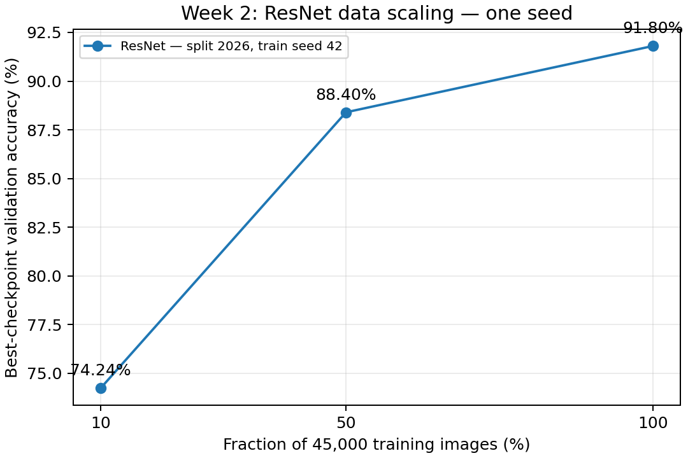

# Kết quả tuần 2 — Minh, 14/11/2026

> Cập nhật giao thức nhóm: ViT P0 hiện hành dùng AdamW lr **0.0003**, wd 0.05, 100 epoch theo `configs/week2/vit_{10,50,100}.yaml`. Recipe ViT lr 0.001 trong các số liệu tuning dưới đây là lịch sử, không phải lựa chọn nhóm hiện tại. Ba run ResNet 100 epoch vẫn khớp giao thức.

## Phạm vi đã hoàn tất

Đã pull main `6211fe0`, tích hợp pipeline/split chính của Hiền và ViT tự cài của Lan Anh; đối chiếu tham số, tuning ngang ngân sách rồi khóa recipe. Đã huấn luyện **đủ ba lượt ResNet × 100 epoch**, một cặp seed `(split=2026, train=42)`, giữ nguyên ResNet 272.474 tham số. Không chạy test chính thức. Lượt ViT chính vẫn dành cho Lan Anh; bốn pilot tuning không được tính là các lượt chính.

## Kết quả chính tuần 2 (validation)

| Tỷ lệ | Ảnh train | Epoch | Số cập nhật | Best epoch | Đúng / 5.000 | Best validation accuracy | Train tổng (giây) | Train+val tổng (giây) |
|---|---:|---:|---:|---:|---:|---:|---:|---:|
| 10% | 4,500 | 100 | 3,600 | 96 | 3,712 | 74.24% | 104.29 | 159.33 |
| 50% | 22,500 | 100 | 17,600 | 89 | 4,420 | 88.40% | 498.78 | 553.73 |
| 100% | 45,000 | 100 | 35,200 | 95 | 4,590 | 91.80% | 1001.87 | 1057.29 |

Mỗi dòng chỉ **một seed**, std mẫu **N/A**. Đây là accuracy validation của **best.pt**, không phải accuracy test và không nhất thiết là checkpoint cuối epoch 100. Evaluator của Hiền nạp từng best.pt và khớp chính xác best validation accuracy đã ghi trong trainer.

Train tổng khoảng **26.75 phút**; cộng train+validation khoảng **29.51 phút**, chưa gồm khởi động tiến trình, checkpoint/TensorBoard và đánh giá lại cuối. Cả ba lượt có bộ nhớ CUDA cấp phát đỉnh khoảng **276,20 MiB**, không phải toàn VRAM tiến trình.

## Recipe và số liệu tuning

- Cùng ảnh 32×32, batch 128, random crop padding 4/flip ngang và chuẩn hóa của Hiền; num_workers=0, FP32, deterministic algorithms; từ đầu, không pretrained.
- Hai mô hình cùng hai recipe × 10 epoch trên 50% dữ liệu, cùng seed. ResNet: SGD **77,74%**, AdamW **72,20%**; ViT: SGD **50,24%**, AdamW **55,02%** best validation.
- Chọn **ResNet SGD lr=0,05, momentum=0,9, weight_decay=0,0005**; **ViT AdamW lr=0,001, weight_decay=0,05**.
- Run chính khởi tạo mới, giữ recipe riêng theo kiến trúc, dùng cosine schedule **100 epoch** cho mọi tỷ lệ. Không tiếp tục từ checkpoint tuning 10 epoch.
- Khóa trước train chính tại [locked_protocol.json](../../configs/week2/locked_protocol.json). Bảng tuning riêng: [tuning.csv](tuning.csv).

## Hình và nhận xét có thể dùng trong báo cáo

Accuracy validation tăng từ **74,24% → 88,40% → 91,80%** khi tăng lượng train 10% → 50% → 100%. Mức tăng lần lượt **14,16** và **3,40 điểm phần trăm**. Đây là quan sát ResNet trên một split/seed với recipe đã chọn, chưa phải kết luận CNN so với ViT hoặc bằng chứng nhân quả về inductive bias.

Ở cuối 100 epoch, train accuracy lần lượt **99,07% / 99,47% / 99,31%**, còn validation cuối **74,24% / 88,36% / 91,70%**. Khoảng cách train/validation lớn hơn khi ít dữ liệu; learning curve 10% có train loss giảm rất thấp trong khi validation loss còn cao, phù hợp dấu hiệu overfitting. Train accuracy được đo trong chế độ train với augmentation, nên khoảng cách này là chỉ báo định tính, không phải một phép đo generalization gap hoàn toàn cùng điều kiện.

Các đường validation có dao động giai đoạn lr cao; sau khi cosine giảm lr thì ổn định hơn. Chọn best theo accuracy nên validation loss không bắt buộc nhỏ nhất tại cùng epoch. Không tinh chỉnh recipe theo hình/test sau khi đã khóa loạt chính.

## Bằng chứng và tái lập

- [resnet_runs.csv](resnet_runs.csv): metadata đầy đủ từng lượt — config, commit, source/manifest/checkpoint hash, accuracy, thời gian, số bước. Cùng protocol ID ở cả ba tỷ lệ.
- [resnet_summary.csv](resnet_summary.csv): bảng một seed với std mẫu NaN/N/A, không giả lập mean/std qua ba lần đánh giá cùng checkpoint.
- [resnet_d10_metrics.csv](resnet_d10_metrics.csv), [resnet_d50_metrics.csv](resnet_d50_metrics.csv), [resnet_d100_metrics.csv](resnet_d100_metrics.csv): đủ 100 dòng epoch cho mỗi lượt.
- [minh_week2_checks.json](minh_week2_checks.json): kiểm tra config/manifest/param/source hash, 100 epoch, 3.600/17.600/35.200 cập nhật, best checkpoint và TensorBoard 1–100 không thiếu/trùng.
- **36 test đạt, không test nào bị skip**; compileall và diff whitespace đạt. Kiểm tra mutation còn xác nhận test bắt được việc nhận ứng viên tuning chạy thiếu epoch.
- Source hash các lượt chính đều khớp khóa `13399304c170e55b98cde1ab859f5652ffab15a2ee1dfae04e7513f35fac9edb`. HEAD commit giữa lượt có khác do thêm comment/tài liệu/script; không có thay đổi `src` hay recipe giữa các run, metadata ghi trạng thái từng lượt.
- Checkpoint/config/metadata/TensorBoard/dự đoán validation tại `runs/week2/resnet_d10_s42`, `resnet_d50_s42`, `resnet_d100_s42`; stdout tại `runs/week2/logs/`. Các file lớn không đưa vào Git; nhóm cần sao lưu ngoài repo.
- Script đánh giá lại: `python -X utf8 -m scripts.run_minh_week2 --stage collect`; vẽ lại: `python -X utf8 -m scripts.plot_minh_week2`.

## Phần bàn giao và phần còn lại

- [Bàn giao Minh tuần 2](../../docs/minh-week2.md), [bản Method–CNN](../../reports/method_minh_week2.md), [cấu hình ViT cùng giao thức](../../configs/week2/vit_d10_s42.yaml) để Lan Anh/Hiền tiếp tục.
- Swin prototype thư viện torchvision: **261.824 tham số**, đã kiểm tra forward/backward ảnh RGB 32×32, **chưa train Swin**. Đây là đúng phạm vi chuẩn bị ngày 13; huấn luyện mở rộng thực hiện sau các lượt chính.
- Chưa có ba lượt ViT chính của Lan Anh trong phiên này, nên chưa đánh dấu checkpoint chung đủ 6 lượt/attention hoàn thành.
- Hai cặp seed bổ sung ResNet `(2027,43)`, `(2028,44)` thuộc tuần 3; giữ nguyên recipe/epoch. Test cuối thuộc giai đoạn sau khi khóa toàn bộ phương pháp.
- Việc Minh tự đọc/giải thích code, xác nhận với hai bạn, nơi chia sẻ/sao lưu log cần thao tác thực tế của nhóm. File ghi chú không thay thế điểm vấn đáp.
